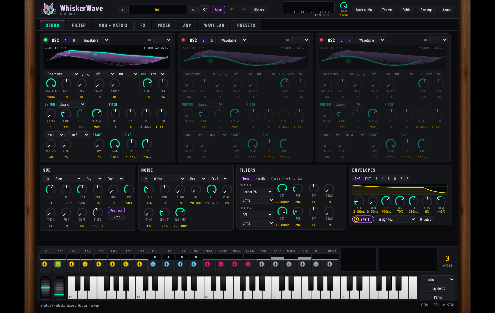
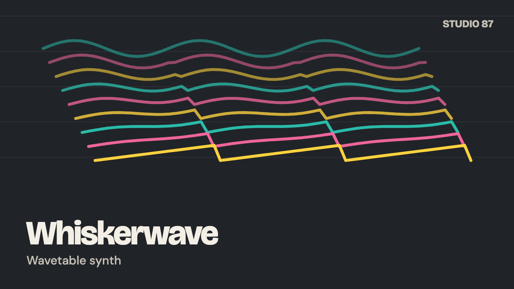

# Whiskerwave 🐈🌊

Free, open source wavetable synth for Linux (VST3). Wavetable oscillators with morphing, layered voices, a flexible modulation matrix, built-in effects, and a tool to sample your own hardware into wavetables. Ships with CC0 waveforms and waves made by code. Tuned for dance, house, UK hardcore and hardstyle. AGPL-3.0.

## Status
**Playable preview v1.9.13.** The full design runs as an interactive mockup with its own sound engine, offline, in Chrome, Edge or Firefox on Linux, macOS and Windows.
- Download: [WhiskerWave preview release](https://github.com/SpeakingColors/whiskerwave-vst/releases/tag/v1.9.13-preview) (one zip: WhiskerWave.html, PDF manual, INSTALL.txt).
- Or open [`docs/mockup/index.html`](docs/mockup/index.html) from this repo in your browser.

The VST3 plugin is **not released yet**: it comes after the C++ port of this exact design. The C++ code in `src/` is still an early scaffold with a placeholder window and is not shipped.

What the preview has: 6 wavetable oscillators (wavetable, sample and grain engines, unison up to 8, 12 warp modes, FM/AM/ring), sub and noise, 2 filters with 47 types, 8 envelopes, 4 LFOs, drag-to-modulate matrix, 30 effects on tracks and buses, mixer, arp, Wave Lab and 72 presets. Sound quality work so far (measured, not yet heard by ear): lookahead limiter, zero-delay ladder filters, 4x oversampled warp/FM oscillators and distortion effects, phase-aligned dry/wet mixing.

  

☕ Free and open source, made by one person. If it helps your music, a coffee on [Ko-fi](https://ko-fi.com/studio87) keeps it coming. 💜

## What is in here today
- `tools/gen_waves.py` and `tools/gen_waves2.py`: make 38 original single-cycle waves from math (basic shapes, organ, vowels, FM, wavefolding, saw stacks, comb, reed, brass, screech and more). Run `python3 tools/gen_waves.py waves` then `python3 tools/gen_waves2.py waves`.
- `waves/`: the generated waves (2048 samples, mono, 16-bit WAV, no DC offset).
- `tools/gen_midi.py` and `midi/`: 9 original 4-bar test patterns (hardstyle, happy hardcore, UK hardcore, rolling bass, funk bass, pads, range check).
- `tools/audition.py`: renders any wave through any pattern to a WAV so you can listen right away. Example: `python3 tools/audition.py waves/fm_growl_1_2.wav hardstyle_lead_150`

## Planned
- Wavetable synth plugin on cat-ui
- Wave and shape generator with a MIDI test-drive: audition a new wave instantly against example MIDI patterns (hardstyle leads, happy hardcore, basses, funk) and keep what sounds good
- Hardware capture tool: plays notes through your own synths over MIDI, records them, cuts them into wavetables and samples
- Import of CC0 waveform packs such as AKWF

## Docs
- [Roadmap](ROADMAP.md)
- [Design notes](docs/DESIGN.md)
- [Sources and licensing](docs/SOURCES.md)

## License
AGPL-3.0-or-later, see [LICENSE](LICENSE).

Not affiliated with or endorsed by any other synth or sample maker. Names of other products are used only to describe features. No third-party samples or presets are included.
